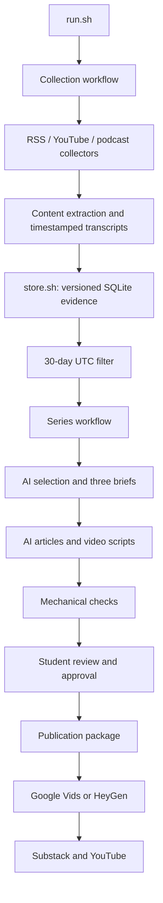

# Problem Set 4 Student Submission

Complete this document with your project details and links. Keep the course instructions in [README.md](README.md) and the required contracts in [ARCHITECTURE.md](ARCHITECTURE.md).

**Student:** Ghaida486 (GitHub username; student to confirm submission name)
**GitHub repository:** https://github.com/Ghaida486/ps04---Beyond-the-Target-

## Topic and Audience

- **Publication name:** Beyond the Target
- **Topic:** Women's competitive archery
- **Audience and assumed knowledge:** Female club archers who understand basic shooting and scoring and want to progress into competition.
- **Central question:** What can aspiring female competitors learn from recent developments in women's competitive archery, and how strong is the evidence?
- **Scope and exclusions:** Recent competition developments, athlete experiences, access and progression. Distinguish recurve, compound and para categories. Exclude bowhunting, unsupported health/training prescriptions, sales claims without independent evidence, and undated/outdated material.
- **Reason for readers to return:** Track meaningful developments, scrutinize claims and understand what to watch next.

## Published Series

Replace each placeholder with the title or working link. Verify that course staff can open every publication.

| Piece | Title | Substack article | YouTube video |
| --- | --- | --- | --- |
| 1 | New winners, new Olympic places—and the access questions behind them | Pending publication | Pending production |
| 2 | What a victory proves—and what its explanations cannot | Pending publication | Pending production |
| 3 | From following champions to understanding your next competition | Pending publication | Pending production |

**Separate technical demonstration video:** Not recorded yet; see docs/TECHNICAL_DEMO_OUTLINE.md.

## Setup and Execution

See [SETUP.md](SETUP.md) for dependencies, model settings, stage commands and handoffs. See [source research](docs/SOURCE_RESEARCH.md) and [current status](docs/PROJECT_STATUS.md). Codex CLI is authenticated with ChatGPT; its inference connection check passed without an API key. Transcription is local faster-whisper. The earlier exhausted-credit API approach has been replaced. No completed end-to-end assignment run is claimed yet.

After implementation, the required entry commands are:

```bash
bash run.sh
bash run.sh --package runs/RUN_ID
```

Replace `RUN_ID` with an actual run directory. Add any setup or stage-replay commands a reviewer needs.

## Architecture and Manual Handoffs



Each Bash component delegates only its assigned responsibility to a neighboring Python helper. lib/common.py shares I/O, receipts and Codex CLI inference transport; it does not implement stages. Only data/store.py, invoked by store.sh, opens the persistent SQLite index. Exact AI requests/responses and snapshotted prompts are retained per run.

Describe the human editorial review, Google Vids or HeyGen production, and Substack and YouTube publishing steps. Identify the files passed into each manual step and the resulting artifacts.

## Evidence and Runs

Link to the retained evidence, editorial decisions, briefs, content checks, and intermediate artifacts needed to inspect the complete workflow. Keep referenced text and transcript files accessible. Explain how to retrieve media omitted from the repository.

| Run | Actual date | Run artifacts and logs | Elapsed time | Approximate cost |
| --- | --- | --- | --- | --- |
| First live run | To complete | Add path or link | To complete | To complete |
| Second live run | To complete | Add path or link | To complete | To complete |

Explain what changed between runs. Identify unknown or estimated costs. Provide the records demonstrating duplicate handling, the date-window checks, and collection failure or recovery. Label any fixture replay or simulated failure.

Trace one published claim to its brief, editorial decision, source version, and exact supporting passage or timestamp.

## Editorial Review

Link to the editorial policy and prompts used. Provide your review of at least three accepted and three rejected or deferred items, comparing the AI's reasons with your own judgment.

Show the policy before and after your revision, the affected stage outputs, and what changed. Record factual corrections, remaining limitations, and the evidence for your final publication approval.

## Reflection

Explain one insight the system produced, one editorial failure or limitation, and the next improvement you would make. Discuss one architectural tradeoff and why your choice fits this project.


## Current observed completion

See [START_HERE.md](START_HERE.md) for the actual drafts and next student actions. The current run is [runs/20261014T175929Z-d79199](runs/20261014T175929Z-d79199). It has 28 eligible stored items, seven producer identities and 16 accepted editorial decisions. All three articles and three scripts exist; mechanical checks pass. Narration has 547, 540 and 501 words. No publication or student approval is claimed.

The run needed source/attribution and intended-piece repairs; their prior outputs and explicit rationales are preserved. The [policy record](docs/POLICY_REVISION.md) labels assistant changes and pending student review. [Claim tracing](runs/20261014T175929Z-d79199/claim_trace.md) connects a draft claim to its source. [Replay proof](runs/20261014T175929Z-d79199/demonstrations/replay-summary.json) records 32 unchanged inputs. Earlier attempts and this recovery all occurred on 14 October; the second successful live day remains pending.

Costs for ChatGPT-authenticated Codex calls are unknown in per-call dollars and are not reported as zero; actual prompts, execution events and usage are retained. Local transcription has no provider API charge and consumed computer time. Consult each run's receipts and summary for actual elapsed time and stage outcomes.

The [reflection draft](docs/REFLECTION_DRAFT.md) is based on observed artifacts and requires the student's own assessment/rewrite. The student must still complete the six-item review, examine the policy change, verify claims/audio and give final approval, complete another live day, produce/publish the series, record the technical demonstration and enter actual links.
