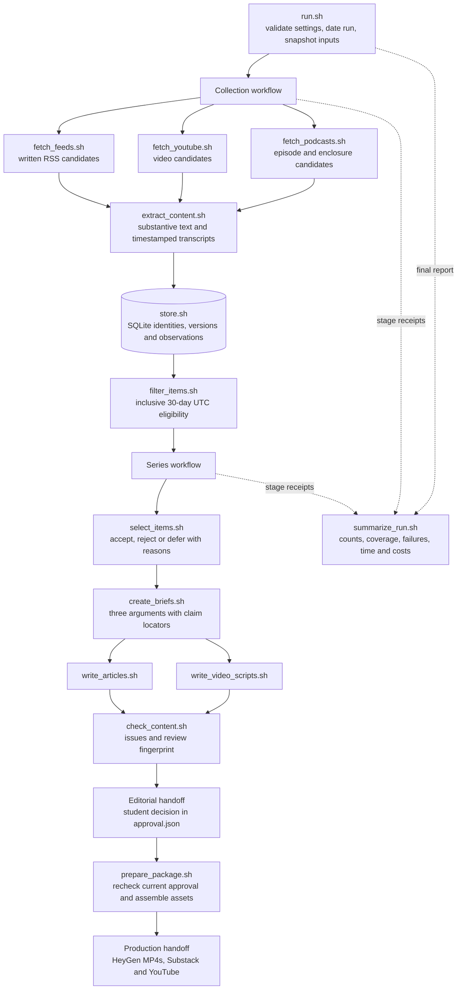

# Beyond the Target — PS4 Submission

Student: Ghaida Aljuhani (GitHub: Ghaida486)
Repository: https://github.com/Ghaida486/ps04---Beyond-the-Target-

## Topic and Audience

**Beyond the Target** is an evidence-led publication about women’s competitive archery, written for female club archers moving toward competition.

| Editorial choice | Definition |
| --- | --- |
| Audience knowledge | Readers understand basic shooting and scoring; they need context for choosing competitive opportunities and assessing advice. |
| Recurring question | What changed in women’s competitive archery, which claims are supported, and what do those developments mean for a club archer’s next step? |
| Scope | Competition results, qualification, athlete experience, discipline-specific demands, facilities and practical access. Recurve, compound, field, 3D and para categories remain distinct. |
| Exclusions | Bowhunting, unsupported training or health prescriptions, sales claims without adequate evidence, and undated or stale material. |
| Reason to return | Each edition connects a dated development to an audience decision, tests the evidence behind appealing claims, and identifies a concrete question to watch next. |
| Editorial voice | Clear, practical and fair to athletes, with explicit distinctions between reported facts, personal testimony and inference. |

The three pieces form a progression: **what changed → what the evidence supports → what participation requires**. The policy is saved in [config/editorial_policy.md](config/editorial_policy.md); the publication brief is in [config/project.json](config/project.json).

## Published Series

All three article/video pairs are published and cross-linked. Articles are free to access; YouTube videos are unlisted. The separate technical walkthrough is also published unlisted. Signed-in page checks passed. The student reported on October 15 that all videos worked; the student later reported all articles worked after the signed-out/private-browser instructions. A detailed pronunciation audit has not been certified.

| Piece | Title | Substack | YouTube |
|---|---|---|---|
| 1 | New winners, different pathways: what changed in women’s archery | [Article](https://ghaidaaljuhani.substack.com/p/new-winners-different-pathways-what) | [Video](https://youtu.be/DCXB8fzMp9k) |
| 2 | What survives scrutiny when athletes explain success? | [Article](https://ghaidaaljuhani.substack.com/p/what-survives-scrutiny-when-athletes) | [Video](https://youtu.be/FIagOjRQ5vw) |
| 3 | From eligibility to attendance: what developing competitors should watch | [Article](https://ghaidaaljuhani.substack.com/p/from-eligibility-to-attendance-what) | [Video](https://youtu.be/n3WfhCMNlc0) |

Separate technical demonstration: [Beyond the Target — PS4 Technical Demonstration](https://youtu.be/BR01y6eM5SM) — 4:40 as displayed by YouTube. Synthetic narration and retained-evidence walkthrough disclosed.

## Setup and Execution

The full pipeline uses Bash for orchestration, Python helpers for each component, the ChatGPT-authenticated Codex CLI for editorial inference, and local faster-whisper for timestamped transcription. `yt-dlp` retrieves YouTube material; `ffmpeg` supports media retrieval/finishing. BeautifulSoup extracts supported written article bodies. Dependency installation, source configuration and recovery commands are documented in [SETUP.md](SETUP.md).

```bash
# Start a fresh, dated collection and editorial run.
bash run.sh

# After reviewing that run and recording its current approval.json:
bash run.sh --package runs/NEW_RUN_ID
```

`run.sh` validates the project/source settings through `lib/new_run.py`, assigns the UTC as-of date, snapshots `config/` and `prompts/`, initializes the evidence store, calls both workflows and writes the run summary. Replace `NEW_RUN_ID` with the newly created run; it is not a literal directory name.

**Provider and cost boundary.** The four AI responsibilities are selection, briefs, articles and scripts. They use the Codex CLI default model with no configured model override. The wrapper supplies the saved prompt, policy and evidence to an isolated read-only inference process; it removes API-key variables and has no paid-API fallback. Exact request/response/telemetry records remain in the local archive. Model-call dollar costs are **unknown**, because subscription allowance is consumed without an assigned per-call price. Local Whisper uses CPU int8 inference (`base.en` in the submitted runs); local processing time is real even when a provider charge is absent.

**Reproduction boundary.** The original approved package was checked against the complete locally retained evidence. This public repository supplies labeled claim-support excerpts for inspection. They resolve citations but are not byte-identical to the original assets, so the historical approval must not be reused to repackage altered evidence. Use the offline verification commands below to inspect this release; use a fresh full run and its own review/approval for new production.

## Architecture and Manual Handoffs

### Component boundaries and data flow

The architecture separates **evidence state**, **editorial judgment** and **release authority**. `run.sh` and the two workflows coordinate stages; substantive processing stays in the component that owns it. JSON Lines streams make intermediate results inspectable and let compatible stages be rerun independently.



| Responsibility | Owning components | Inspectable contract |
| --- | --- | --- |
| Run coordination | [run.sh](run.sh), [collect_sources.sh](workflows/collect_sources.sh), [create_series.sh](workflows/create_series.sh) | Establish the run and sequence stages; preserve component outputs and exit status. |
| Source discovery | [fetch_feeds.sh](collectors/fetch_feeds.sh), [fetch_youtube.sh](collectors/fetch_youtube.sh), [fetch_podcasts.sh](collectors/fetch_podcasts.sh) | Emit candidate metadata, original/publication dates and media locations into separate candidate streams. |
| Evidence preparation | [extract_content.sh](processing/extract_content.sh), [filter_items.sh](processing/filter_items.sh) | Produce normalized records, retained text/transcript assets, eligible records and explicit date exclusions. |
| Persistent state | [store.sh](data/store.sh) and its adjacent helper | Own the SQLite index through `init`, `upsert`, `list` and `get`; emit `new`, `changed` or `unchanged` observations. |
| Editorial reasoning | [select_items.sh](editorial/select_items.sh), [create_briefs.sh](editorial/create_briefs.sh) | Turn eligible evidence into justified decisions and three distinct briefs; every claim names an exact source version and passage or segment. |
| Audience adaptation | [write_articles.sh](content/write_articles.sh), [write_video_scripts.sh](content/write_video_scripts.sh) | Generate the article and narration from the same brief and evidence, preserving claim markers. |
| Review and release preparation | [check_content.sh](review/check_content.sh), [prepare_package.sh](publishing/prepare_package.sh) | Assess references and consistency, fingerprint the reviewed inputs, and require a passing current review plus matching student approval before packaging. |
| Reporting | [summarize_run.sh](reporting/summarize_run.sh) | Report coverage, duplicates, stage failures, elapsed time, known/unknown costs and separately recorded publication links. |

**State ownership.** Only `data/store.sh` and `data/store.py` directly access `data/evidence/index.sqlite3`. Other stages query the store interface. Source text and timestamped segments are separate files under `data/assets/`; original downloads belong under `data/media/`. Stable item identities and version hashes distinguish a changed source from a repeated retrieval. Retrieval time is excluded from the version hash, so observing the same material tomorrow does not create a new version.

**Shared infrastructure.** [lib/common.py](lib/common.py) supplies JSON I/O, dates, receipts and model transport; [lib/workflow.sh](lib/workflow.sh) supplies workflow receipts. [content/generation_support.py](content/generation_support.py) supports the two generators. These helpers do not run the entire pipeline behind the sixteen entry points. Each substantive component remains independently callable. For example, the freshness filter consumes a retained corpus without recollecting it:

```bash
bash processing/filter_items.sh runs/NEW_RUN_ID \
  < runs/NEW_RUN_ID/corpus.jsonl \
  > runs/NEW_RUN_ID/eligible.jsonl
```

This command is for a new or deliberate replay run: it writes exclusion records and a stage receipt. The offline verifier below uses a disposable copy so inspection does not rewrite the submitted run history.

### Review gates and failure behavior

Operational success and editorial approval are separate. A content-check invocation can complete successfully while returning `passed: false`; packaging inspects that result, recomputes the current fingerprint and rejects stale or missing approval. A matching historical `review.json`/`approval.json` pair therefore documents a particular set of reviewed inputs, rather than general permission to publish future drafts.

Collector failures retain usable partial results and failed receipts. The summary lists failed/incomplete stages separately from content readiness; both fields must be inspected. The October 15 DNS failure and subsequent retry are preserved rather than represented as a successful empty collection. Warnings about reasoning, attribution or transcription require judgment beyond a process exit code.

### Manual handoffs: inputs, decisions and outputs

Platform production is outside the Bash pipeline. The following handoffs were completed through the interactive tools with student authorization; `prepare_package.sh` itself does not render videos, publish posts or claim they are live.

| Handoff | Input | Decision or acceptance check | Output / record |
| --- | --- | --- | --- |
| Editorial approval | Decisions, briefs, source passages, article/script drafts and `review.json` | The student reviews the work and records `approve` or `revise` for the current `review_id`. Changes require reassessment. | [Completed source review](runs/20261015T161701Z-ddbccc/student_review/student_responses.json) and [approval.json](runs/20261015T161701Z-ddbccc/approval.json). |
| Production package | Passing checks and matching approval | The packager verifies the current inputs before copying articles/scripts and resolving source notes. | [Package manifest](runs/20261015T161701Z-ddbccc/package/manifest.json), three articles, three scripts and source notes. This is an automated gate after a human decision. |
| HeyGen production | Approved narration and visual directions | Produce 3–5-minute videos with the fictional presenter; add persistent AI disclosure and source-credit slates locally. | Three final MP4s; [audience production manifest](publishing/production/audience-videos.json) records platform links and measured durations. |
| Substack publication | Article text, source references, as-of date and matching video | Publish for Everyone without paid access; subscriber email/app delivery was disabled. | Three article URLs; final article copies are in [published-articles](publishing/production/published-articles). |
| YouTube publication | MP4, article URL, source links and presentation disclosure | Set unlisted visibility, not-made-for-kids audience and AI-use disclosure; save reciprocal links. | Three video URLs and the stored [descriptions](publishing/production). |
| Technical demonstration | Actual code, run records, claim trace, policy correction and tradeoff | Keep the separate narrated walkthrough within 4–6 minutes and disclose synthetic narration. | [Technical demo](https://youtu.be/BR01y6eM5SM) and its [production record](publishing/production/technical-demo.json). |
| Release verification | All seven URLs and final media | Check publication status and cross-links; the student confirmed video playback and article access after private-browser instructions. Automated transcription flags support a further listening check. | [Publication links](runs/20261015T161701Z-ddbccc/package/publication_links.json), [final review record](docs/FINAL_REQUIREMENTS_REVIEW.json) and [audio review](publishing/production/audio-review). |

`awaiting_review` means the automated content is ready for a person to assess; `ready_for_production` means the package has matched review/approval records. Neither status means that an external platform has published anything. The recorded URLs and production manifests provide that separate evidence. Historical package manifests and run summaries retain their creation-time manual-step notes; this submission and the release records report the completed platform handoffs.

## Verification and Reproducibility

```bash
python3 -m pip install -r requirements-test.txt
python3 -m unittest discover -s tests -v
python3 tools/verify_submission.py
```

The verifier runs the actual `data/store.sh` and `processing/filter_items.sh` in a disposable copy. Starting from the first-day corpus, it reproduces the second-day three new items and 29 unchanged inputs; a second replay yields 32 unchanged inputs. The freshness result is exactly the retained 31-item eligible set with ten out-of-window exclusions. It also checks all sixteen scripts, both days’ configuration/prompt snapshots, claim-to-passage references, review coverage, publication links and duration/length targets. It makes no network or model calls and does not touch the production evidence index or student approval. [Inspect the measured report](docs/REPRODUCIBILITY_REPORT.json). GitHub Actions is configured to run these same commands on pushes and pull requests.

The public-excerpt content check has no blocking errors; its new fingerprint is kept separately from the historical full-archive approval. [Inspect the export check](docs/PUBLIC_EXPORT_CONTENT_CHECK.json). An automated transcription cross-check of all four final MP4 audio tracks is also retained in [audio-review](publishing/production/audio-review). Recognition differences flag proper names, number spellings and homophones for listening; they are not proof of pronunciation correctness.

## Evidence and Run History

| Run | Actual UTC date | Elapsed time in summary | Observations |
|---|---|---|---|
| 20261014T175929Z-d79199 | October 14, 2026 | 1,386.31 seconds | 28 eligible items; 16 accepted decisions; recovery stages retained |
| 20261015T161701Z-ddbccc | October 15, 2026 | 1,709.83 seconds | 31 eligible items; 23 accepted, 5 rejected, 3 deferred; 3 new and 29 unchanged collection inputs |

The October 15 eligible set contains 26 written-feed items, two podcast items and three YouTube items across seven producer identities. Independence and meaningfulness require claim-level judgment; the counts alone do not establish corroboration. Publication dates are separate from collection dates. The final series has an as-of date of October 15, 2026 and uses the inclusive September 16–October 15 UTC evidence window.

- [runs/20261015T161701Z-ddbccc/comparison.json](https://github.com/Ghaida486/ps04---Beyond-the-Target-/blob/main/runs/20261015T161701Z-ddbccc/comparison.json)
- [runs/20261015T161701Z-ddbccc/policy_comparison.md](https://github.com/Ghaida486/ps04---Beyond-the-Target-/blob/main/runs/20261015T161701Z-ddbccc/policy_comparison.md)
- [runs/20261014T175929Z-d79199/demonstrations/replay-summary.json](https://github.com/Ghaida486/ps04---Beyond-the-Target-/blob/main/runs/20261014T175929Z-d79199/demonstrations/replay-summary.json)
- [runs/20261015T161648Z-66e801/run.json](https://github.com/Ghaida486/ps04---Beyond-the-Target-/blob/main/runs/20261015T161648Z-66e801/run.json)
- [docs/LOCAL_EVIDENCE.md](https://github.com/Ghaida486/ps04---Beyond-the-Target-/blob/main/docs/LOCAL_EVIDENCE.md)
- [docs/TRANSCRIPT_REVIEW_NOTES.md](https://github.com/Ghaida486/ps04---Beyond-the-Target-/blob/main/docs/TRANSCRIPT_REVIEW_NOTES.md)

The failed October 15 attempt records DNS failures; the subsequent retry completed collection. The earlier replay retained 32 unchanged inputs. New discoveries need not be newly published stories. Extraction repairs are not new source developments. Per-call Codex costs are unknown, not zero; local transcription incurs computer time without a transcription-provider charge. Run summaries and stage receipts retain measured time and usage.

## Editorial Review and Corrections

[Completed review and original-record provenance](runs/20261015T161701Z-ddbccc/student_review/student_responses.json) preserves six direct student decisions with AI-assisted rationale provenance. The sample includes three AI-accepted and three AI-rejected/deferred cases. The student rejected the mixed-topic Podium Archer episode, broadened discipline relevance for Julie Jones’s 3D participation account, and retained translation safeguards for Trajectory. Relevance acceptance does not verify translated claims.

[docs/POLICY_REVISION_V3.md](https://github.com/Ghaida486/ps04---Beyond-the-Target-/blob/main/docs/POLICY_REVISION_V3.md) documents the authorized revision; [config/editorial_policy-v2.md](https://github.com/Ghaida486/ps04---Beyond-the-Target-/blob/main/config/editorial_policy-v2.md) and [config/editorial_policy.md](https://github.com/Ghaida486/ps04---Beyond-the-Target-/blob/main/config/editorial_policy.md) retain before/after policy. The October 15 affected stages were rerun. Sources and policy changed together, so the comparison is not a controlled policy-only experiment.

The disputed team-match score was removed because Indian Express and Times of India disagree. The rejected podcast was removed from revised briefs. Podcast testimony uses programme-level attribution because individual speakers remain unresolved. Field and 3D accounts are not presented as proof of target-training benefits.

Content review: [runs/20261015T161701Z-ddbccc/assistant_content_review.md](https://github.com/Ghaida486/ps04---Beyond-the-Target-/blob/main/runs/20261015T161701Z-ddbccc/assistant_content_review.md). Student production approval: [runs/20261015T161701Z-ddbccc/approval.json](https://github.com/Ghaida486/ps04---Beyond-the-Target-/blob/main/runs/20261015T161701Z-ddbccc/approval.json). Rendered media timing and signed-in publication status were verified. All four videos were also reported working by the student; the student also confirmed all three articles worked after being instructed to test them signed out.

## Reflection

The central insight is that formal eligibility and usable access answer different questions. World Archery’s indoor rules identify who may enter; Julie Jones’s account and the Ladies on the Line discussion identify time and facilities as conditions of participation. Connecting them adds a question that none answers alone: what must be in place for an eligible club archer to attend? The sources support that reporting question, not a claim that access is improving or that one training arrangement causes better scores.

The most consequential editorial failure was accepting a long mixed-topic Podium Archer episode because relevant passages could be extracted from it. The student rejected that focus judgment. The revised policy retained Julie Jones’s 3D participation experience, rejected the unfocused episode, and distinguished Trajectory’s relevance from the reliability of its translated claims. The later briefs excluded the rejected episode. This improved editorial fit while leaving the translation problem unresolved. It also exposed a limit in numerical checks: having enough sources does not make a source useful to this audience.

The architectural tradeoff is inspectability against cost and processing time. Separate collectors, immutable version identifiers and timestamp locators make a claim traceable and allow unchanged media to be reused. Local Whisper avoids a transcription-provider charge but can mishear names, and repeated inference consumes Codex allowance whose per-call dollar cost is unknown. The next improvement would be a review queue for consequential names, scores and speaker identities before brief generation, followed by direct reporting from amateur and disabled competitors. Success would be measured by fewer deferred attribution problems and clearer evidence for the practical access questions, rather than by collecting more links. This reflection is AI-assisted synthesis of recorded runs and the student’s documented source judgments; it does not invent additional personal review or interviews.

## Production Quality and Access Checks

The three audience videos were generated directly in HeyGen using a fictional presenter and the Noelle voice, then finished locally with persistent AI disclosure and source-credit slates. Final durations are 214.68, 206.04 and 216.00 seconds. The separate technical walkthrough is 279.46 seconds (YouTube displays 4:40), with disclosed macOS Samantha synthetic narration over readable excerpts of actual retained project records. It is not live execution or the student speaking.

Production records and narration are in [publishing/production](publishing/production). Article/video cross-links were saved in both directions. All three articles were published for Everyone with email/app delivery disabled; all four YouTube videos are unlisted. YouTube reported no issues during upload checks. The student subsequently reported that all videos worked. That confirms a user playback report, not a documented word-by-word audio audit.

Validation: thirteen automated tests passed on October 15. Full MP4 decode checks passed for all four final videos. External web retrieval could not fetch the seven publication links, so it provided no independent anonymous-access result. No broken-link conclusion is drawn from that tool failure.

Remaining verification limitation: article access was confirmed by the student after the private-browser check instructions; a detailed independent pronunciation/name audit has not been certified. No course-portal submission has been performed. The student will submit the repository.

## Evidence Export and Reuse Limits

Both live runs include their configuration and prompt snapshots, collector streams, normalized records, eligible inventories and corpus exports. Referenced source paths resolve to labeled supporting excerpts and timestamp segments; full source assets and the operational SQLite index remain in the local archive. See [LOCAL_EVIDENCE.md](docs/LOCAL_EVIDENCE.md) and [index reconstruction](data/evidence/README.md). Historical approval fingerprints refer to the complete original local evidence; the public excerpt export is not byte-identical to that archive.
