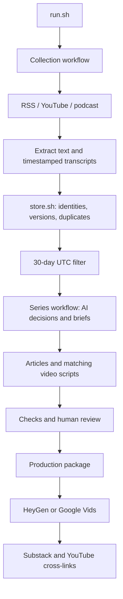

# Problem Set 4 — Beyond the Target

Student: Ghaida Aljuhani (GitHub: Ghaida486)
Repository: https://github.com/Ghaida486/ps04---Beyond-the-Target-

## Purpose and audience

Beyond the Target covers women's competitive archery for female club archers who understand basic shooting and scoring and are considering competition. Its recurring question is: what can aspiring female competitors learn from recent developments, and how strong is the evidence? It distinguishes results, qualification, discipline-specific experience and usable access. Bowhunting, unsupported training or health prescriptions, undated material and sales claims without sufficient evidence are excluded.

## Publication status

All three article/video pairs are published and cross-linked. Articles are free to access; YouTube videos are unlisted. The separate technical walkthrough is also published unlisted. Signed-in page checks passed. The student reported on October 15 that all videos worked; this does not establish a detailed pronunciation audit or anonymous article access.

| Piece | Title | Substack | YouTube |
|---|---|---|---|
| 1 | New winners, different pathways: what changed in women’s archery | [Article](https://ghaidaaljuhani.substack.com/p/new-winners-different-pathways-what) | [Video](https://youtu.be/DCXB8fzMp9k) |
| 2 | What survives scrutiny when athletes explain success? | [Article](https://ghaidaaljuhani.substack.com/p/what-survives-scrutiny-when-athletes) | [Video](https://youtu.be/FIagOjRQ5vw) |
| 3 | From eligibility to attendance: what developing competitors should watch | [Article](https://ghaidaaljuhani.substack.com/p/from-eligibility-to-attendance-what) | [Video](https://youtu.be/n3WfhCMNlc0) |

Separate technical demonstration: [Beyond the Target — PS4 Technical Demonstration](https://youtu.be/BR01y6eM5SM) — 4:40 as displayed by YouTube. Synthetic narration and retained-evidence walkthrough disclosed.

## Execution and architecture

```bash
bash run.sh
bash run.sh --package runs/20261015T161701Z-ddbccc
```

run.sh coordinates two workflows. Collection invokes the RSS, YouTube and podcast collectors, substantive extraction/transcription, persistent storage and the 30-day UTC filter. Series creation invokes AI selection, three briefs, article/script drafting and checks. Human review precedes the production package. Each Bash stage has a focused Python helper; only data/store.sh and its helper access the persistent evidence database. Settings, sources, editorial policy and prompts are retained separately.



Setup and dependencies: [SETUP.md](https://github.com/Ghaida486/ps04---Beyond-the-Target-/blob/main/SETUP.md). Component contracts: [ARCHITECTURE.md](https://github.com/Ghaida486/ps04---Beyond-the-Target-/blob/main/ARCHITECTURE.md).

## Retained runs and evidence

| Run | Actual UTC date | Elapsed time in summary | Observations |
|---|---|---|---|
| 20261014T175929Z-d79199 | October 14, 2026 | 1,386.31 seconds | 28 eligible items; 16 accepted decisions; recovery stages retained |
| 20261015T161701Z-ddbccc | October 15, 2026 | 1,709.83 seconds | 31 eligible items; 23 accepted, 5 rejected, 3 deferred; 3 new and 29 unchanged collection inputs |

The October 15 eligible set contains 26 written-feed items, two podcast items and three YouTube items across seven producer identities. Independence and meaningfulness require claim-level judgment; the counts alone do not establish corroboration. Publication dates are separate from collection dates. The final series has an as-of date of October 15, 2026 and uses the inclusive September 16–October 15 UTC evidence window.

- [runs/20261015T161701Z-ddbccc/comparison.json](https://github.com/Ghaida486/ps04---Beyond-the-Target-/blob/main/runs/20261015T161701Z-ddbccc/comparison.json)
- [runs/20261015T161701Z-ddbccc/policy_comparison.md](https://github.com/Ghaida486/ps04---Beyond-the-Target-/blob/main/runs/20261015T161701Z-ddbccc/policy_comparison.md)
- [runs/20261014T175929Z-d79199/demonstrations/replay-summary.json](https://github.com/Ghaida486/ps04---Beyond-the-Target-/blob/main/runs/20261014T175929Z-d79199/demonstrations/replay-summary.json)
- [runs/20261015T161648Z-66e801/run.json](https://github.com/Ghaida486/ps04---Beyond-the-Target-/blob/main/runs/20261015T161648Z-66e801/run.json)
- [docs/LOCAL_EVIDENCE.md](https://github.com/Ghaida486/ps04---Beyond-the-Target-/blob/main/docs/LOCAL_EVIDENCE.md)
- [docs/TRANSCRIPT_REVIEW_NOTES.md](https://github.com/Ghaida486/ps04---Beyond-the-Target-/blob/main/docs/TRANSCRIPT_REVIEW_NOTES.md)

The failed October 15 attempt records DNS failures; the subsequent retry completed collection. The earlier replay retained 32 unchanged inputs. New discoveries need not be newly published stories. Extraction repairs are not new source developments. Per-call Codex costs are unknown, not zero; local transcription incurs computer time without a transcription-provider charge. Run summaries and stage receipts retain measured time and usage.

## Editorial judgment and corrections

[runs/20261014T175929Z-d79199/student_review/student_responses.json](https://github.com/Ghaida486/ps04---Beyond-the-Target-/blob/main/runs/20261014T175929Z-d79199/student_review/student_responses.json) preserves six direct student decisions with AI-assisted rationale provenance. The sample includes three AI-accepted and three AI-rejected/deferred cases. The student rejected the mixed-topic Podium Archer episode, broadened discipline relevance for Julie Jones’s 3D participation account, and retained translation safeguards for Trajectory. Relevance acceptance does not verify translated claims.

[docs/POLICY_REVISION_V3.md](https://github.com/Ghaida486/ps04---Beyond-the-Target-/blob/main/docs/POLICY_REVISION_V3.md) documents the authorized revision; [config/editorial_policy-v2.md](https://github.com/Ghaida486/ps04---Beyond-the-Target-/blob/main/config/editorial_policy-v2.md) and [config/editorial_policy.md](https://github.com/Ghaida486/ps04---Beyond-the-Target-/blob/main/config/editorial_policy.md) retain before/after policy. The October 15 affected stages were rerun. Sources and policy changed together, so the comparison is not a controlled policy-only experiment.

The disputed team-match score was removed because Indian Express and Times of India disagree. The rejected podcast was removed from revised briefs. Podcast testimony uses programme-level attribution because individual speakers remain unresolved. Field and 3D accounts are not presented as proof of target-training benefits.

Content review: [runs/20261015T161701Z-ddbccc/assistant_content_review.md](https://github.com/Ghaida486/ps04---Beyond-the-Target-/blob/main/runs/20261015T161701Z-ddbccc/assistant_content_review.md). Student production approval: [runs/20261015T161701Z-ddbccc/approval.json](https://github.com/Ghaida486/ps04---Beyond-the-Target-/blob/main/runs/20261015T161701Z-ddbccc/approval.json). Rendered media timing and signed-in publication status were verified. All four videos were also reported working by the student; anonymous article access remains unverified.

## Reflection draft

The series connects formal opportunity with usable access. A national quota or published entry rule establishes one condition; personal accounts reveal time, facilities and equipment constraints without establishing their prevalence. The useful synthesis is to ask what formal eligibility leaves unexplained.

A limitation is dependence on federation promotion and elite experience, compounded by unreliable transcription of names and translated passages. One improvement is to add direct amateur and disabled-competitor reporting and verify consequential audio passages before synthesis. Architecturally, ChatGPT-authenticated Codex inference and local Whisper avoid separate API-key billing, but consume subscription allowance and local processing time. Preserving exact evidence versions and receipts supports correction and replay. This reflection is assistant-drafted for student assessment.

## Production and final verification

The three audience videos were generated directly in HeyGen using a fictional presenter and the Noelle voice, then finished locally with persistent AI disclosure and source-credit slates. Final durations are 214.68, 206.04 and 216.00 seconds. The separate technical walkthrough is 279.46 seconds (YouTube displays 4:40), with disclosed macOS Samantha synthetic narration over readable excerpts of actual retained project records. It is not live execution or the student speaking.

Production records and narration are in [publishing/production](publishing/production). Article/video cross-links were saved in both directions. All three articles were published for Everyone with email/app delivery disabled; all four YouTube videos are unlisted. YouTube reported no issues during upload checks. The student subsequently reported that all videos worked. That confirms a user playback report, not a documented word-by-word audio audit.

Validation: ten isolated contract tests passed on October 15. Full MP4 decode checks passed for all four final videos. External web retrieval could not fetch the seven publication links, so it provided no independent anonymous-access result. No broken-link conclusion is drawn from that tool failure.

Remaining verification limitation: anonymous course-staff access to the articles and independent pronunciation/name checks have not been certified. No course-portal submission has been performed. The student will submit the repository.
