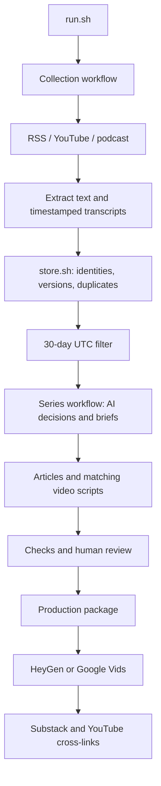

# Problem Set 4 — Beyond the Target

Student: Ghaida Aljuhani (GitHub: Ghaida486)
Repository: https://github.com/Ghaida486/ps04---Beyond-the-Target-

## Purpose and audience

Beyond the Target covers women's competitive archery for female club archers who understand basic shooting and scoring and are considering competition. Its recurring question is: what can aspiring female competitors learn from recent developments, and how strong is the evidence? It distinguishes results, qualification, discipline-specific experience and usable access. Bowhunting, unsupported training or health prescriptions, undated material and sales claims without sufficient evidence are excluded.

## Publication status

All three article/video pairs are published and cross-linked. Articles are free to access; YouTube videos are unlisted. The separate technical walkthrough is also published unlisted. Signed-in page checks passed. The student reported on October 15 that all videos worked; the student later reported all articles worked after the signed-out/private-browser instructions. A detailed pronunciation audit has not been certified.

| Piece | Title | Substack | YouTube |
|---|---|---|---|
| 1 | New winners, different pathways: what changed in women’s archery | [Article](https://ghaidaaljuhani.substack.com/p/new-winners-different-pathways-what) | [Video](https://youtu.be/DCXB8fzMp9k) |
| 2 | What survives scrutiny when athletes explain success? | [Article](https://ghaidaaljuhani.substack.com/p/what-survives-scrutiny-when-athletes) | [Video](https://youtu.be/FIagOjRQ5vw) |
| 3 | From eligibility to attendance: what developing competitors should watch | [Article](https://ghaidaaljuhani.substack.com/p/from-eligibility-to-attendance-what) | [Video](https://youtu.be/n3WfhCMNlc0) |

Separate technical demonstration: [Beyond the Target — PS4 Technical Demonstration](https://youtu.be/BR01y6eM5SM) — 4:40 as displayed by YouTube. Synthetic narration and retained-evidence walkthrough disclosed.

## Execution and architecture

```bash
bash run.sh
bash run.sh --package runs/20261015T161701Z-ddbccc
```

run.sh coordinates two workflows. Collection invokes the RSS, YouTube and podcast collectors, substantive extraction/transcription, persistent storage and the 30-day UTC filter. Series creation invokes AI selection, three briefs, article/script drafting and checks. Human review precedes the production package. Each Bash stage has a focused Python helper; only data/store.sh and its helper access the persistent evidence database. Settings, sources, editorial policy and prompts are retained separately.



Setup and dependencies: [SETUP.md](https://github.com/Ghaida486/ps04---Beyond-the-Target-/blob/main/SETUP.md). Component contracts: [ARCHITECTURE.md](https://github.com/Ghaida486/ps04---Beyond-the-Target-/blob/main/ARCHITECTURE.md).

## Reproduce the submitted evidence without model access

```bash
python3 -m pip install -r requirements-test.txt
python3 -m unittest discover -s tests -v
python3 tools/verify_submission.py
```

The verifier runs the actual `data/store.sh` and `processing/filter_items.sh` in a disposable copy. Starting from the first-day corpus, it reproduces the second-day three new items and 29 unchanged inputs; a second replay yields 32 unchanged inputs. The freshness result is exactly the retained 31-item eligible set with ten out-of-window exclusions. It also checks all sixteen scripts, both days’ configuration/prompt snapshots, claim-to-passage references, review coverage, publication links and duration/length targets. It makes no network or model calls and does not touch the production evidence index or student approval. [Inspect the measured report](docs/REPRODUCIBILITY_REPORT.json). GitHub Actions is configured to run these same commands on pushes and pull requests.

The public-excerpt content check has no blocking errors; its new fingerprint is kept separately from the historical full-archive approval. [Inspect the export check](docs/PUBLIC_EXPORT_CONTENT_CHECK.json). An automated transcription cross-check of all four final MP4 audio tracks is also retained in [audio-review](publishing/production/audio-review). Recognition differences flag proper names, number spellings and homophones for listening; they are not proof of pronunciation correctness.

## Retained runs and evidence

| Run | Actual UTC date | Elapsed time in summary | Observations |
|---|---|---|---|
| 20261014T175929Z-d79199 | October 14, 2026 | 1,386.31 seconds | 28 eligible items; 16 accepted decisions; recovery stages retained |
| 20261015T161701Z-ddbccc | October 15, 2026 | 1,709.83 seconds | 31 eligible items; 23 accepted, 5 rejected, 3 deferred; 3 new and 29 unchanged collection inputs |

The October 15 eligible set contains 26 written-feed items, two podcast items and three YouTube items across seven producer identities. Independence and meaningfulness require claim-level judgment; the counts alone do not establish corroboration. Publication dates are separate from collection dates. The final series has an as-of date of October 15, 2026 and uses the inclusive September 16–October 15 UTC evidence window.

- [runs/20261015T161701Z-ddbccc/comparison.json](https://github.com/Ghaida486/ps04---Beyond-the-Target-/blob/main/runs/20261015T161701Z-ddbccc/comparison.json)
- [runs/20261015T161701Z-ddbccc/policy_comparison.md](https://github.com/Ghaida486/ps04---Beyond-the-Target-/blob/main/runs/20261015T161701Z-ddbccc/policy_comparison.md)
- [runs/20261014T175929Z-d79199/demonstrations/replay-summary.json](https://github.com/Ghaida486/ps04---Beyond-the-Target-/blob/main/runs/20261014T175929Z-d79199/demonstrations/replay-summary.json)
- [runs/20261015T161648Z-66e801/run.json](https://github.com/Ghaida486/ps04---Beyond-the-Target-/blob/main/runs/20261015T161648Z-66e801/run.json)
- [docs/LOCAL_EVIDENCE.md](https://github.com/Ghaida486/ps04---Beyond-the-Target-/blob/main/docs/LOCAL_EVIDENCE.md)
- [docs/TRANSCRIPT_REVIEW_NOTES.md](https://github.com/Ghaida486/ps04---Beyond-the-Target-/blob/main/docs/TRANSCRIPT_REVIEW_NOTES.md)

The failed October 15 attempt records DNS failures; the subsequent retry completed collection. The earlier replay retained 32 unchanged inputs. New discoveries need not be newly published stories. Extraction repairs are not new source developments. Per-call Codex costs are unknown, not zero; local transcription incurs computer time without a transcription-provider charge. Run summaries and stage receipts retain measured time and usage.

## Editorial judgment and corrections

[Completed review and original-record provenance](runs/20261015T161701Z-ddbccc/student_review/student_responses.json) preserves six direct student decisions with AI-assisted rationale provenance. The sample includes three AI-accepted and three AI-rejected/deferred cases. The student rejected the mixed-topic Podium Archer episode, broadened discipline relevance for Julie Jones’s 3D participation account, and retained translation safeguards for Trajectory. Relevance acceptance does not verify translated claims.

[docs/POLICY_REVISION_V3.md](https://github.com/Ghaida486/ps04---Beyond-the-Target-/blob/main/docs/POLICY_REVISION_V3.md) documents the authorized revision; [config/editorial_policy-v2.md](https://github.com/Ghaida486/ps04---Beyond-the-Target-/blob/main/config/editorial_policy-v2.md) and [config/editorial_policy.md](https://github.com/Ghaida486/ps04---Beyond-the-Target-/blob/main/config/editorial_policy.md) retain before/after policy. The October 15 affected stages were rerun. Sources and policy changed together, so the comparison is not a controlled policy-only experiment.

The disputed team-match score was removed because Indian Express and Times of India disagree. The rejected podcast was removed from revised briefs. Podcast testimony uses programme-level attribution because individual speakers remain unresolved. Field and 3D accounts are not presented as proof of target-training benefits.

Content review: [runs/20261015T161701Z-ddbccc/assistant_content_review.md](https://github.com/Ghaida486/ps04---Beyond-the-Target-/blob/main/runs/20261015T161701Z-ddbccc/assistant_content_review.md). Student production approval: [runs/20261015T161701Z-ddbccc/approval.json](https://github.com/Ghaida486/ps04---Beyond-the-Target-/blob/main/runs/20261015T161701Z-ddbccc/approval.json). Rendered media timing and signed-in publication status were verified. All four videos were also reported working by the student; the student also confirmed all three articles worked after being instructed to test them signed out.

## Reflection — written with AI assistance

The central insight is that formal eligibility and usable access answer different questions. World Archery’s indoor rules identify who may enter; Julie Jones’s account and the Ladies on the Line discussion identify time and facilities as conditions of participation. Connecting them adds a question that none answers alone: what must be in place for an eligible club archer to attend? The sources support that reporting question, not a claim that access is improving or that one training arrangement causes better scores.

The most consequential editorial failure was accepting a long mixed-topic Podium Archer episode because relevant passages could be extracted from it. The student rejected that focus judgment. The revised policy retained Julie Jones’s 3D participation experience, rejected the unfocused episode, and distinguished Trajectory’s relevance from the reliability of its translated claims. The later briefs excluded the rejected episode. This improved editorial fit while leaving the translation problem unresolved. It also exposed a limit in numerical checks: having enough sources does not make a source useful to this audience.

The architectural tradeoff is inspectability against cost and processing time. Separate collectors, immutable version identifiers and timestamp locators make a claim traceable and allow unchanged media to be reused. Local Whisper avoids a transcription-provider charge but can mishear names, and repeated inference consumes Codex allowance whose per-call dollar cost is unknown. The next improvement would be a review queue for consequential names, scores and speaker identities before brief generation, followed by direct reporting from amateur and disabled competitors. Success would be measured by fewer deferred attribution problems and clearer evidence for the practical access questions, rather than by collecting more links. This reflection is AI-assisted synthesis of recorded runs and the student’s documented source judgments; it does not invent additional personal review or interviews.

## Production and final verification

The three audience videos were generated directly in HeyGen using a fictional presenter and the Noelle voice, then finished locally with persistent AI disclosure and source-credit slates. Final durations are 214.68, 206.04 and 216.00 seconds. The separate technical walkthrough is 279.46 seconds (YouTube displays 4:40), with disclosed macOS Samantha synthetic narration over readable excerpts of actual retained project records. It is not live execution or the student speaking.

Production records and narration are in [publishing/production](publishing/production). Article/video cross-links were saved in both directions. All three articles were published for Everyone with email/app delivery disabled; all four YouTube videos are unlisted. YouTube reported no issues during upload checks. The student subsequently reported that all videos worked. That confirms a user playback report, not a documented word-by-word audio audit.

Validation: thirteen automated tests passed on October 15. Full MP4 decode checks passed for all four final videos. External web retrieval could not fetch the seven publication links, so it provided no independent anonymous-access result. No broken-link conclusion is drawn from that tool failure.

Remaining verification limitation: article access was confirmed by the student after the private-browser check instructions; a detailed independent pronunciation/name audit has not been certified. No course-portal submission has been performed. The student will submit the repository.

## Repository evidence scope

Both live runs include their configuration and prompt snapshots, collector streams, normalized records, eligible inventories and corpus exports. Referenced source paths resolve to labeled supporting excerpts and timestamp segments; full source assets and the operational SQLite index remain in the local archive. See [LOCAL_EVIDENCE.md](docs/LOCAL_EVIDENCE.md) and [index reconstruction](data/evidence/README.md). Historical approval fingerprints refer to the complete original local evidence; the public excerpt export is not byte-identical to that archive.
